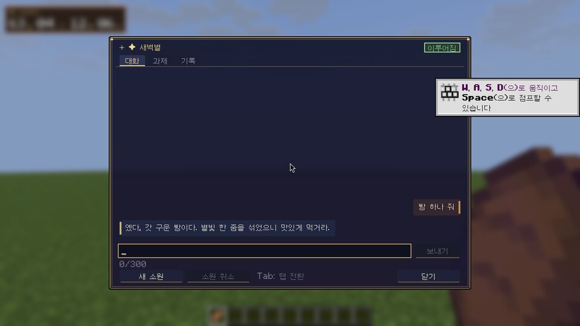
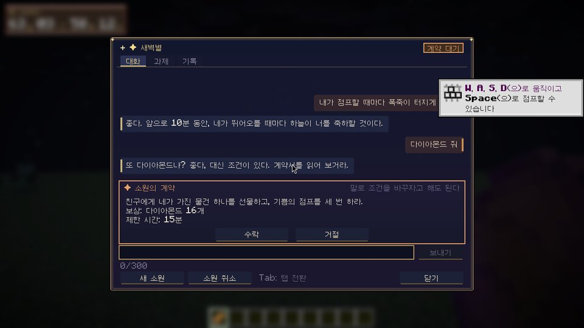
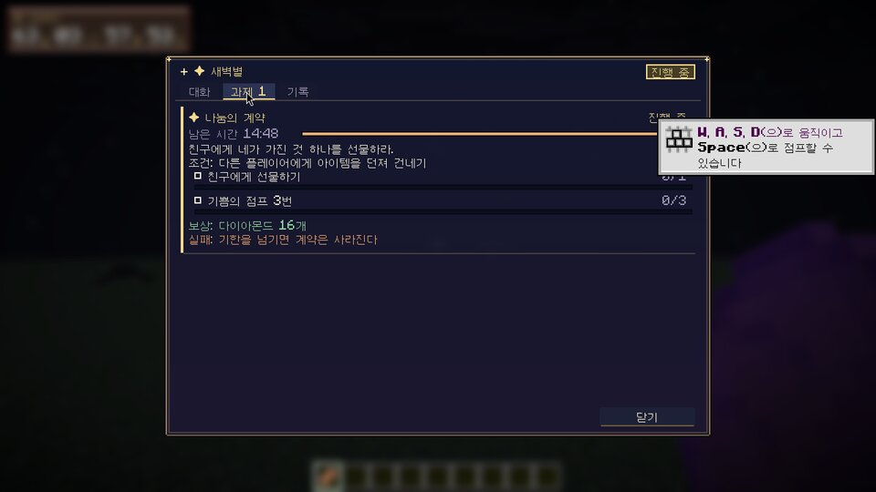
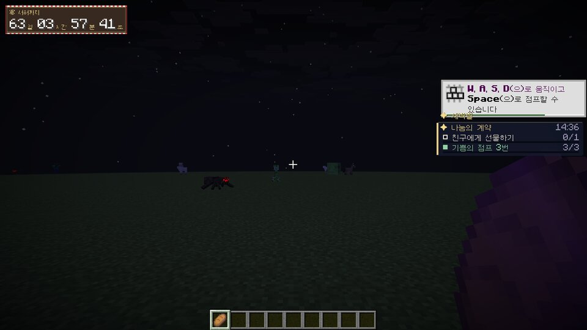
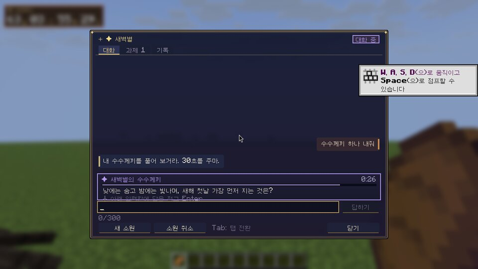
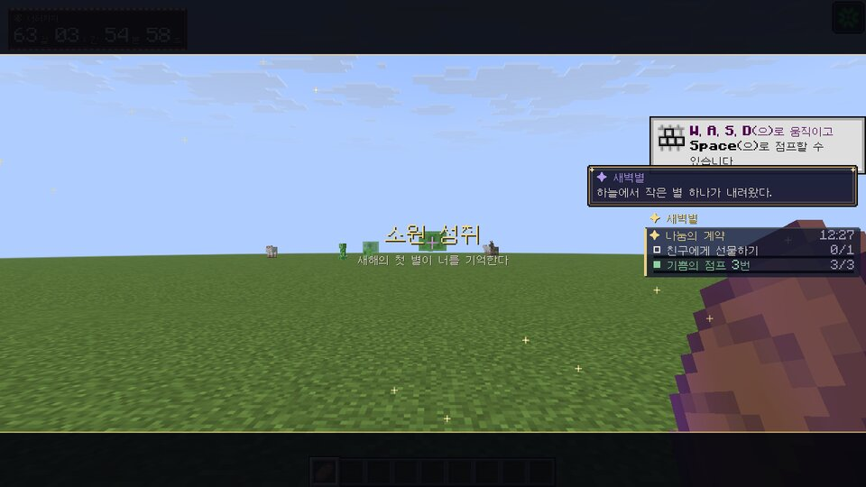
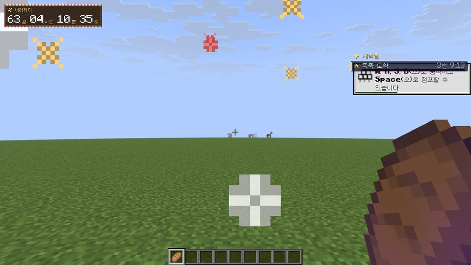
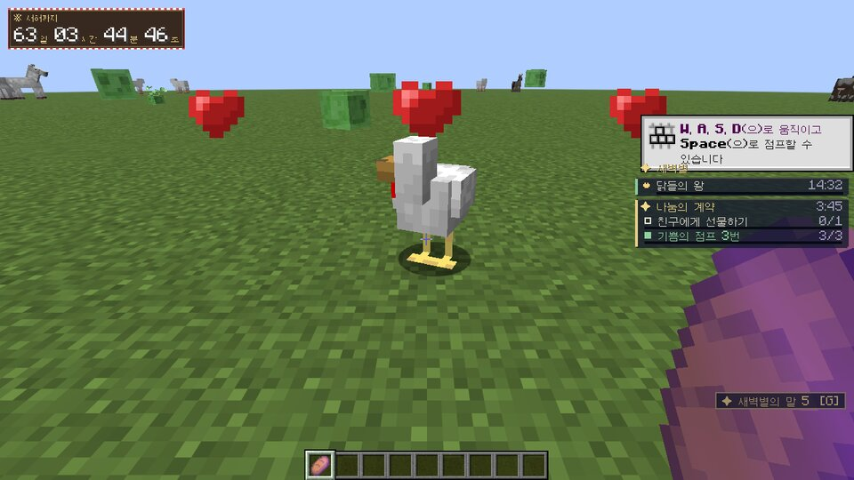

# AI 소원 엔진 — 새벽별 (AI Wish & World Creation Engine)

플레이어가 자연어로 소원을 빌면 AI(새벽별)가 들어줄지 판단하고, 협상하고, 필요하면 **서버 안에서 실행되는 새 게임 로직(WishScript)을 직접 작성·검증·실행**한다.
만들어진 능력·규칙·퀘스트·생명체는 세계에 남고, AI 는 그 일을 기억해 다음 소원과 자율 사건에 이어 쓴다.

> 이 문서의 내용은 실제 구현과 맞춘 것이다. 현재 기본 모델은 `gpt-6.1-sol`이다. 실제 OpenAI API 호출은 아직 시험하지 못했다(키 없음) — 아래 「시험한 내용」 참고.

---

## 1. 전체 구조

```
플레이어 ─(대화 화면 G / /wish / 소원 연등)─▶ WishManager ─▶ WishAgent (작업 스레드)
                                                         │   OpenAI Responses API (도구 호출 루프, 구조화 출력)
                                                         │      ▲          │ function_call
                                                         │      │결과      ▼
                                                         └──── Tools (서버 스레드에서 실행, 입력 검증)
                                                                 ├ 세계/플레이어 조회 · 기억 검색/저장
                                                                 ├ 스크립트 검증(모의 실행)·활성화·수정·정지
                                                                 ├ UI 도구(선택지·입력·계약·퀘스트·알림·시네마틱)
                                                                 └ 소원 상태 관리
ScriptManager ── WishScript 인터프리터(샌드박스) × N ── 게임 이벤트 버스(믹스인/Fabric 이벤트)
UiService ──(선언형 UI JSON 패킷)──▶ 클라이언트 디자인 시스템(대화 화면·퀘스트 패널·HUD·토스트·시네마틱)
MemoryStore(플레이어/세계/서사 기억) · AiState(소원·퀘스트·스크립트·상태) · UsageTracker → 월드 폴더 JSON
AutonomyManager: 의미 있는 사건이 생겼을 때만 AI 에게 자율 판단을 맡김
```

| 계층 | 패키지 | 주요 클래스 |
|---|---|---|
| AI | `ai.openai`, `ai.agent` | `OpenAiClient`(Responses + Embeddings, 재시도·Rate limit·취소), `AgentRunner`(도구 루프·출력 복구), `WishAgent`(큐·동시성·예산·병합·의미 검색 보충), `Tools`, `Prompts`, `ContextBuilder`, `ApiDocs` |
| 스크립트 | `ai.script.lang` | `Lexer`/`Parser`/`Interpreter`(JS 부분집합), `Budget`, `StaticChecker`, `Stdlib`, `ClosureCodec`/`FuncIndex`(클로저 저장·복구), `HeapMeter`(바이트 단위 힙 측정) — Minecraft 와 무관한 순수 자바 |
| 스크립트 ↔ 게임 | `ai.script`, `ai.script.api` | `ScriptApi`(전역 API), `PlayerRef`/`EntityRef`/`QuestRef`/`ModelRef`, `Policy`(권한·범위·수량), `ScriptValidator`(검증·모의 실행·블록 계획), `ScriptManager`(생명주기·스케줄러·이벤트·행동·목표·모델·영역·정리·롤백), `Continuations`(재시작 이어 돌리기), `Goals`(엔티티 AI 목표), `Models`(조립 모델), `Textures`(동적 텍스처) |
| 소원 | `ai.wish` | `Wish`(상태 기계), `WishManager`, `Quest`/`QuestService`, `StatusEntry` |
| 기억 | `ai.memory` | `MemoryRecord`(사적/공유/공개), `MemoryStore`(중복 제거·키워드+의미 검색·공유·요약 대체·가지치기), `SemanticIndex`(임베딩 색인) |
| UI | `ai.ui`, `ai.net`, `client.ai` | `UiService`(서버), `AdminService`(관리자 화면·명령 공용), `AiPackets`, `AiClientState`, `WishUi`(디자인 시스템), `WishChatScreen`, `AiHud`, `AdminScreen`/`AdminCodeScreen`/`BlockPreviewScreen`, `BlockPreview`(유령 블록), `DynamicTextures`(텍스처·아이템 렌더러) |
| 세계 | `ai` | `GameEvents`(이벤트 연결), `ai.mixin.*`(빈 서버 일시정지 판단 포함), `AutonomyManager` |
| 관리 | `ai` | `AiCommands`, `AiConfig`, `AiStorage`, `UsageTracker`, `SelfTest` |

### 스크립트 언어를 직접 만든 이유
후보(Lua/LuaJ, Rhino/GraalJS, 별도 프로세스, DSL)를 비교한 결과 **자바스크립트 부분집합 인터프리터를 직접 구현**했다.
- AI 가 가장 잘 쓰는 문법(화살표 함수·구조 분해·템플릿 문자열)을 그대로 쓸 수 있다 → 표현력.
- 언어 차원에서 자바 객체·리플렉션·파일·네트워크·스레드에 닿는 경로가 **아예 없다**. 스크립트는 `HostObject` 로 노출한 API 만 본다.
- 모든 노드 평가가 예산(단계 수·할당량·호출 깊이·실제 시간)을 소모하므로 무한 루프·폭주 재귀·메모리 폭주를 확실히 끊을 수 있다(예산 오류는 `try/catch` 로도 잡히지 않음).
- 서버 JVM 안에서 돌지만 외부 프로세스 없이 틱 단위로 정밀하게 스케줄된다.

## 2. 실제로 완성된 기능

- **소원 입력**: 대화 화면(기본 키 `G`), `/wish <소원>`, 기존 **소원 연등**(연등이 떠오른 뒤 새벽별이 응답).
- **자유로운 판단, 단 공짜는 없다**: 거절/일부/질문/협상/계약/조건/퀘스트/대가/시간 제한/부작용/단계적 실현 — 고정 패턴 없이 모델이 고른다. 다만 **아주 작은 소원**(빵 하나, 횃불, 씨앗 몇 개, 반짝이·폭죽 같은 무해한 연출, 귀띔)만 바로 들어주고, 그 밖의 모든 소원에는 **값어치에 맞는 조건**(작은 소원 = 작은 심부름·공정한 교환·수수께끼, 중간 = 목표가 있는 퀘스트·의미 있는 희생·협동·시간 제한 도전, 큰 소원 = 여러 단계 퀘스트나 무거운 계약 — 또는 거절)을 걸고, 조건을 채운 **뒤에** 준다. 공손하게 빌거나 졸라도, 급하다 해도 대가는 사라지지 않고, 비슷한 것을 최근에 받았으면 대가가 오른다. 서버도 막는다: 플레이어 소원으로 **영구 능력**(`activate_script lasting:true`)을 주려면 그 소원에 수락된 계약이나 완료된 퀘스트가 있어야 한다(`requireConditionForLastingAbilities`). 시스템 지시문은 공정성·기억 정직성·안전 규칙도 강제한다.
- **소원 쿨타임**: 새 소원은 한 사람당 60초에 하나(`wishCooldownSeconds`, 재시작해도 이어짐). 진행 중인 소원의 대답·협상은 막지 않는다. OP 는 `/wishai cooldown set <초>` 로 바꾸고 `/wishai cooldown reset <플레이어|all>` 로 초기화한다.
- **원래 세계를 바꾸는 소원**: 빈 공간뿐 아니라 **자연 지형**(돌·흙·모래·자갈·광석·눈·얼음, 놓지 않은 나뭇잎과 그 나무의 원목, 꽃·풀, 물)을 깎고 쌓고 바꿀 수 있다 — 언덕·분화구·호수·평탄화(`world.terraform`), 구·상자·바꿔치기·파내기(`sphere/box/replace/clear`), 진짜 나무(`world.grow`, 바닐라 나무 생성기), 한 칸 파기(`setBlock(pos, 'air')`), 시간·날씨. 큰 변경은 틱마다 조금씩(스크립트당 64칸, 서버 전체 256칸) 반짝이며 진행되고, 끝나면 `world_edit_done` 이벤트, 재시작해도 이어진다.
  - **지은 것은 보호**: 가공한 블록(판자·벽돌·유리·양털·콘크리트…), 플레이어가 놓은 나뭇잎, 잎이 없는 원목(통나무집), 상자 같은 내용물 블록, 그리고 그런 블록에 **맞닿은 자연 칸**(집 밑 흙)은 바꾸지 않는다(마을 같은 자연 구조물도 같이 보호된다). 용암·불은 놓을 수 없다. 모든 변경은 기록되어 롤백된다.
  - 시간·날씨는 모두의 하늘이라 관리자 승인 대신 **서버 전체 10분에 한 번**(`skyChangeCooldownMinutes`)이고, 바뀔 때 모든 플레이어에게 "누구의 소원으로 하늘이 바뀐다"고 알린다. 블록 1024칸이 넘는 변경은 관리자 승인(미리보기 화면으로 확인).
  - 설정 `worldEditMode`: `natural`(기본) / `empty_only`(예전처럼 빈 공간만) / `any`(내용물 블록만 빼고 무엇이든). 예전 설정 파일은 처음 켤 때 한 번, 예전 기본값을 그대로 둔 항목만 새 기본값으로 옮긴다(블록 한도 512→4096, 승인 기준 128→1024, 시간·날씨 승인 요구 해제 — 로그에 남음).
- **Tool calling 루프**: 여러 번 조회→계획→스크립트 작성→검증→수정→실행→UI 표시. 단순 소원은 1~2회 호출로 끝난다.
- **런타임 프로그래밍**: AI 가 쓴 WishScript 가 이벤트 구독·타이머·영역·상태 저장·엔티티 행동·블록·연출·UI·퀘스트·기억을 조합해 새 게임플레이를 만든다. 검증 실패 시 오류(줄:칸, "did you mean")가 AI 에게 돌아가 고쳐서 다시 시도한다.
- **지속성**: 능력·규칙 스크립트, 그 상태(`state`), 이름 붙은 타이머, 엔티티 행동, 퀘스트 마감, HUD 상태가 서버 재시작 후 복구된다. 주인이 접속해 있지 않아 초기화가 실패하면 주인이 들어올 때 다시 시작한다.
- **통합 UI**: 대화 화면(대화/과제/기록 탭, 응답 대기 애니메이션, 빠른 답, 선택지·입력·계약·동의 카드, 남은 시간 막대), 퀘스트 패널, 오른쪽 HUD(능력·저주·타이머·퀘스트 진행률, `J` 로 접기), 알림 토스트, 레터박스 시네마틱, AI 가 그리는 픽셀 아이콘. 재접속 시 대화·대기 중인 선택지·퀘스트·HUD 가 복구된다.
- **상호작용 검증**: 모든 UI 응답은 고유 ID + nonce. 서버가 주인·만료·중복·재전송·선택지 범위를 검증한다.
- **기억**: 플레이어 사적 기억/세계 공개 기억/서사 연결(thread·related), 관련성(한글 2-gram)·중요도·최근성 점수 검색, 중복 병합, 한도 가지치기, AI 요약으로 오래된 기억 접기. 검색 결과에는 **실제 세계 상태 주석**(스크립트가 지금 ACTIVE/STOPPED/FAULTED 인지, 엔티티가 지금 어디 있는지)이 붙는다.
- **자율 세계 발전**: 오랜만의 접속, 사망, 기억 속 장소 재방문(들어오는 순간), 퀘스트 종료, 특별한 아이템 줍기, 주기적 판단 — 쿨다운·시간당 한도·예산 비율 안에서만 AI 를 부른다. 아무것도 안 하기로 할 수도 있다.
- **운영**: 요청 큐·동시 호출 제한·시간 초과·재시도(지수 백오프, Retry-After)·Rate limit/Quota 구분·취소·플레이어별 쿨다운/일일 한도·서버 일일 예산·토큰/캐시 토큰/추론 토큰/비용/오류율/지연 집계, 킬 스위치, 승인 정책, 스크립트 검사기.
- UI 채널을 모르는 클라이언트에는 채팅 메시지와 클릭 가능한 선택지(`/wish answer`)로 대신 보낸다(폴백).
- **기억 공유**: 사적 기억을 주인이 고른 플레이어와만 나누는 세 번째 단계(사적 → 공유 → 공개). 주인만 공유할 수 있고(`/wish memory share`, 또는 대화 중 주인의 부탁으로 AI 가 `share_memory`), 주인은 언제든 거두거나(`unshare`) 잊게 하거나(`forget`) 아예 잠글 수 있다(`lock`).
- **의미 검색**: 기억을 OpenAI 임베딩으로 색인해 낱말이 달라도 뜻이 가까운 기억을 찾는다(키워드 점수와 합산). 매 턴 키워드 검색이 놓친 기억을 "semantic memory recall" 로 덧붙인다. 키가 없거나 예산이 바닥나면 키워드 검색만.
- **관리자 화면**: `/wishai gui`(또는 단축키) — 상태·비용·킬 스위치, 스크립트 검사기(승인/거부·멈춤·롤백·강제 롤백·이전 버전·삭제), **코드 직접 편집**(검증 → 적용, 버전 기록), 소원·기억 관리.
- **블록 변경 미리보기**: 검증(모의 실행)이 계획한 블록 변경을 층별 평면도·입체도 화면과 월드 속 반투명 유령 블록으로 보여 준다(세계는 그대로). 승인 대기 스크립트, AI 의 `preview_blocks` 도구(플레이어가 동의하기 전에 볼 수 있게)에서 쓴다.
- **재시작을 건너는 클로저**: 기다리던 `after()/every()`, 실행 중에 등록한 `on()`, 엔티티 두뇌 콜백을 붙잡은 지역 변수째 저장했다가 재시작 후 남은 시간대로 이어 돌린다.
- **동적 텍스처·조립 모델·AI 목표**: AI 가 그린 텍스처를 아이템 모습·월드 그림·HUD 아이콘으로, 디스플레이 엔티티를 묶은 3D 모델을, 몹에 진짜 AI 목표(지키기·도망·공격·배회·순찰·스크립트 두뇌)를 붙인다.

## 3. 추가·변경된 파일

- 신규: `src/main/java/dev/newyear/countdown/ai/**` (서버·공용), `src/main/java/dev/newyear/countdown/client/ai/**` (클라이언트), `src/main/resources/newyearcountdown.ai.mixins.json`, `src/test/java/**`, `docs/WISH_AI.md`, `docs/wish-ai/*.jpg`.
  - §11·§12 작업으로 더해진 것: `ai/memory/SemanticIndex`, `ai/ui/AdminService`, `ai/script/{Continuations, Goals, Models, Textures}`, `ai/script/api/ModelRef`, `ai/script/lang/{ClosureCodec, FuncIndex, HeapMeter}`, `ai/mixin/DedicatedServerMixin`, `client/ai/{AdminClient, AdminScreen, AdminCodeScreen, BlockPreview, BlockPreviewScreen, DynamicTextures}`, `mixin/SpecialModelRenderersAccessor`(클라이언트), `assets/newyearcountdown/items/wish_texture.json`, 테스트 `MemorySharingTest`, `EmbeddingsClientTest`, `ContinuationsTest`.
- 변경(최소): `NewYearCountdown`(엔진 등록 3줄), `NewYearCountdownClient`(패킷 수신·HUD·키 3개·미리보기 렌더러·텍스처 렌더러 등록), `wish/WishLaunch`(연등 소원을 AI 로 전달 1줄), `fabric.mod.json`(공용 믹스인), `newyearcountdown.mixins.json`(접근자 1개), 언어 파일(키 이름), `build.gradle`(JUnit 테스트). 기존 기능은 그대로다.

## 4. API 키와 모델 설정

1. `/wishai gui` → **설정 → 세션 키**에서 임시 키를 입력하거나, 서버 실행 환경에 `OPENAI_API_KEY` 환경 변수를 설정한다. 임시 키는 관리자 전용 요청으로 서버에 전달하며, 설정 파일·로그·서버 응답·JAR에 넣지 않는다.
2. 서버 첫 실행 시 `config/newyearcountdown-ai.json` 이 생긴다. 주요 항목:

| 키 | 기본값 | 설명 |
|---|---|---|
| `model` | `gpt-6.1-sol` | Responses API 모델. 인게임에서 변경 가능 |
| `reasoningEffort` / `autonomyReasoningEffort` | `medium` / `low` | 추론 강도 |
| `apiBase` | `https://api.openai.com/v1` | 프록시를 쓸 때만 변경 |
| `requestTimeoutSeconds`, `maxRetries` | 90, 3 | 요청 제한 시간·재시도 |
| `maxConcurrentRequests`, `maxQueuedRequests` | 3, 24 | 동시 호출·대기열 |
| `maxToolRounds`, `maxToolCallsPerTurn`, `maxOutputTokens` | 14, 48, 16000 | 한 턴의 도구 루프 한도 |
| `priceInputPerMTok` / `priceCachedInputPerMTok` / `priceOutputPerMTok` | 2.5 / 0.25 / 15 | **실제 가격표에 맞게 관리자가 설정** (가격표에 없는 모델의 비용 추정용) |
| `modelPrices` | `{}` | 모델별 가격표 `{"모델 또는 접두어": [입력, 캐시, 출력]}` — `/wishai price` 로 관리. 명시한 가격이 우선이며, Sol은 표준 단가 2 / 0.10 / 10을 내장한다. 다른 모델은 기본 단가로 추정 |
| `priceEmbeddingPerMTok` | 0.02 | 임베딩 단가 (하루 예산에 함께 들어간다) |
| `embeddingsEnabled`, `embeddingModel`, `embeddingDimensions` | true, `text-embedding-3-small`, 256 | 의미 검색. 모델·차원을 바꾸면 색인을 다시 만든다 |
| `embeddingWeight`, `embeddingMinSimilarity`, `embeddingExtraMemories`, `embeddingBatchSize`, `embeddingTimeoutSeconds` | 3.5, 0.25, 5, 32, 8 | 의미 점수 가중치·하한, 턴마다 덧붙일 기억 수, 색인 묶음 크기, 질의 제한 시간 |
| `scriptHeapMaxBytes` | 4 MiB | 스크립트가 붙잡은 값(전역·state·클로저·타이머)의 추정 크기 상한 |
| `scriptPersistClosures` | true | 재시작 때 타이머·리스너·두뇌를 클로저째 이어 돌림 |
| `scriptMaxGoals`, `scriptMaxModels`, `modelMaxParts` | 32, 8, 48 | AI 목표·조립 모델 한도 |
| `maxDynamicTextures`, `dynamicTextureMaxSize` | 256, 32 | 동적 텍스처 수(서버 전체)·최대 크기(픽셀) |
| `keepServerAwakeForScripts` | true | 시간이 흘러야 하는 스크립트가 있으면 빈 서버 일시정지를 막음 |
| `dailyBudgetUsd`, `perPlayerDailyTurns`, `perPlayerCooldownSeconds` | 5.0, 60, 4 | 예산·한도 (`perPlayerCooldownSeconds` 는 말 한마디 사이 간격) |
| `wishCooldownSeconds` | 60 | 새 소원 쿨타임 (0 = 끔). `/wishai cooldown set` 으로도 바꾼다 |
| `requireConditionForLastingAbilities` | true | 플레이어 소원으로 영구 능력을 줄 때 수락된 계약·완료된 퀘스트를 요구 |
| `spiritName`, `extraInstructions` | 새벽별, "" | 페르소나 |
| `script*` | — | 단계/시간/메모리 예산, 리스너·타이머·엔티티·블록 수, 반경, 오류 한도 |
| `allowBlockPlacement`, `worldEditMode` | true, `natural` | 블록 정책: `natural` = 빈 공간 + 자연 지형(지은 것과 그 옆은 보호), `empty_only` = 빈 공간만, `any` = 내용물 블록 빼고 전부. 예전 `allowReplacingSolidBlocks: true` 는 `any` 와 같다 |
| `scriptMaxBlocks`, `scriptBlocksPerTick`, `globalBlocksPerTick` | 4096, 64, 256 | 스크립트당 바꿀 수 있는 칸, 틱당 속도 (점진적 작업은 스크립트당 64 · 서버 전체 256) |
| `approvalRequiredApis`, `approvalBlockThreshold` | (없음) / 1024 | 관리자 승인이 필요한 API·규모 (계획된 블록 수 기준, 모양 함수 포함) |
| `skyChangeCooldownMinutes` | 10 | 시간·날씨 변경의 서버 전체 간격 |
| `requireConsentForOthers` | true | 다른 플레이어에게 해로운 조작은 동의 필요 |
| `autonomy*` | 켜짐, 주기 30분, 시간당 6회, 동시 4개, 블록 변경 금지 … | 자율 이벤트 |
| `memory*` | 플레이어 400 / 세계 1200 / 요약 시작 160 | 기억 |

`/wishai gui` → **설정**에서 주요 항목을 직접 바꾸고 **저장·적용**할 수 있다(OP 2 이상). 파일 편집 후에는 `/wishai reload`로 다시 읽는다. 동시 요청 수·대기열 크기·기억 보관 한도는 서버/싱글플레이 월드 재시작이 필요하다.

### 인게임 설정 (1.2.5)

**임시 API 키 (1.2.6):** 설정 화면 오른쪽 위의 **세션 키**에서 붙여넣고 **임시 적용**을 누른다. OP 2 이상만 사용할 수 있다. 입력은 별표로 표시하고 내레이터도 내용을 읽지 않으며, 전송·닫기·창 크기 변경 시 입력칸을 비운다. 별도의 키 조회 기능은 없고 서버는 `임시 키 / 환경 변수 키 / 키 없음` 상태만 돌려준다.

임시 키는 **현재 서버 전체 AI 요청**에서 환경 변수보다 우선한다. **입력한 관리자의 접속이 끝나거나 서버/싱글플레이 월드를 닫으면 자동 삭제**되며, **임시 키 삭제**로 바로 제거할 수도 있다. 다른 관리자가 새 임시 키를 입력했다면 새 입력자의 접속을 기준으로 한다. 삭제 후에는 기존 환경 변수 키가 있으면 다시 사용한다. 설정 저장·다시 읽기는 임시 키를 파일에 쓰지 않는다. 키 변경은 다음 API 요청부터 반영되며 이미 보낸 요청에는 소급되지 않는다. 적용 버튼은 키를 등록하며 API 유효성·잔액·모델 권한은 실제 요청 시 확인된다.

| 분류 | 편집 가능한 항목 |
|---|---|
| 모델·응답 | 대화 모델, 대화/자율 이벤트 추론 강도, 기억 요약 모델, 최대 출력 토큰, 요청 제한 시간, 재시도, 도구 왕복/호출 한도, 동시 요청 수*, 대기 요청 수*, API 응답 저장 |
| 예산·대화 | 하루 예산, 개인 하루 대화 횟수, 대화 간격, 새 소원 간격, AI 이름, 추가 성격·지시, 영구 능력의 계약/퀘스트 조건 |
| 자율 이벤트 | 켜기/끄기, 주기, 개인/서버 간격, 시간당 호출 수, 동시 사건 수, 블록 변경 허용, 장소 기억 최소 나이, 같은 장소 재반응 간격, 오랜만의 접속 기준 |
| 기억 | 개인/세계 보관 한도*, 대화에 넣는 기억 수, 요약 시작 기준, 의미 검색 켜기/끄기, 추가 기억 수, 검색 가중치, 최소 유사도 |
| 세계·실행 | 블록 변경 허용/범위, 관리자 승인 규모, 시간·날씨 간격, 다른 플레이어 동의, 개인/전체 스크립트 수, 블록 수, 개별/전체 틱당 변경량, 반경, 개별/전체 엔티티 수, 기본 수명, 빈 서버 실행 유지 |

`*`는 재시작 후 적용된다. 모델과 추론 강도는 이미 진행 중인 응답을 중단하지 않고 다음 요청부터 사용한다. 요약 모델을 비우면 대화 모델을 따른다. Sol 추론 강도는 `low`, `medium`, `high`, `xhigh`, `max`이다. 모델 ID를 직접 입력할 수 있으며, 해당 계정의 사용 가능 여부는 API 호출 시 확인된다. 기존 서버의 모델 선택을 자동으로 덮어쓰지는 않는다. 이 저장소의 개발 실행 설정(`run/config/newyearcountdown-ai.json`)은 Sol로 변경했다.

화면은 한국어 설명과 페이지 이동을 제공한다. 여러 분류에서 편집한 값을 한 번에 저장하며, 서버가 범위·형식·모델별 추론 조합을 검사한다. 잘못된 값이 하나라도 있으면 전체 변경을 거부하고 입력 내용을 남긴다. 다른 관리자가 같은 항목을 먼저 바꿨으면 덮어쓰지 않고 다시 불러오도록 안내한다. 저장을 완료한 후 실행 설정을 교체하며, API 키와 격리 테스트 실행 명령은 클라이언트로 보내지 않는다.

파일에서만 설정하는 고급 항목: `apiBase`, `enabled`, `maxMessageLength`, 임베딩 모델·차원·묶음 크기·제한 시간, 스크립트 단계·시간·할당량·힙·상태 저장 크기·오류·검증·리스너·타이머 한도, 클로저 복구, AI 목표·조립 모델·부품·동적 텍스처 한도, 승인 필수 API 목록, 격리 확장 테스트 실행 명령. 모델별 단가는 `/wishai price`로도 변경한다. AI 전체 정지는 기존 관리 화면의 킬 스위치를 사용한다.

Sol 내장 단가는 [공식 OpenAI 모델 문서](https://developers.openai.com/api/docs/models/gpt-6.1-sol)의 표준·짧은 문맥 요율(1M 토큰당 USD)을 기준으로 한다. 비용은 추정치이며 Fast/Ultrafast, 긴 문맥, 지역 처리 등 추가 요율은 자동 계산하지 않는다. 별도 요율은 `modelPrices`로 설정한다.

## 5. 플레이어가 소원을 비는 방법

- **`G`** (조작 설정 "소원 대화")로 대화 화면을 열고 소원을 적는다. 대화가 이어지는 동안은 같은 소원에 대한 대답이 된다. "새 소원" 버튼으로 새로 시작, "소원 취소"로 취소.
- **`/wish 빵 하나 줘`** — 채팅 명령. `/wish cancel`, `/wish history`.
- 새 소원은 **60초에 하나**만 빌 수 있다(남은 시간을 새벽별이 알려 준다). 같은 소원에 대답하거나 협상하는 것은 언제든 된다. 연등은 쿨타임 중에도 날아가지만(연등 기록에는 남는다) 새벽별은 남은 시간만 알려 주고 소원으로 받지 않는다.
- **소원 연등**을 들고 우클릭 → 소원을 적고 "연등 날리기" → 연등이 떠오른 뒤 새벽별이 답한다.
- AI 가 선택지·입력·계약 카드를 띄우면 화면이 자동으로 열린다(다른 화면이 열려 있으면 HUD 에 "새벽별이 대답을 기다린다 [G]").
- 계약 카드에서 **수락/거절**하거나, 말로 조건을 바꾸자고 하면 협상이 이어진다.
- AI 가 건축을 제안하면 동의하기 전에 **유령 블록 미리보기**가 뜰 수 있다 (나에게만 보이고, 세계는 아직 그대로).
- **내 기억 관리** — `/wish memory`(새벽별이 기억하는 나와의 일, ID 포함), `/wish memory shared`(남이 나눠 준 기억), `/wish memory share <ID> <플레이어>`, `/wish memory unshare <ID> [플레이어]`, `/wish memory forget <ID>`, `/wish memory lock` / `unlock`(잠그면 공유를 모두 거두고 AI 도 나누지 못한다). 대화 중에 "민수에게도 우리 비밀을 알려 줘"처럼 부탁하면 AI 가 대신 공유한다 — 남의 기억은 아무도 공유할 수 없다.

## 6. AI 가 쓸 수 있는 스크립트 API (요약)

모델은 `get_script_api(topic)` 도구로 실제 API 표에서 생성된 문서를 받는다(구현과 어긋나지 않음).

- **전역**: `owner`(소원을 빈 플레이어), `state`(재시작 후에도 유지되는 객체), `on/once/off(event, fn, filter?)`, `after/every/cancel`, `timer(name, ticks, data)`(재시작에도 유지), `emit(name, data)`, `region(name, center, radius)`, `now/tick/random/randomInt/chance/pick/shuffle/pos/offset/distance/seconds/minutes/log`, `Math/JSON/Object/Array/Number/String`.
- **world**: `time, day, isDay, isNight, weather, setTime, setWeather, skyReady, block, blockState, isAir, surface, biome, findBlocks, setBlock, fill, structure, restoreBlocks, isLoaded, dimension` + 원래 세계 바꾸기 `terraform(center, r, {shape: hill|crater|lake|flatten, height, surface, fill, liquid}), sphere, box, replace(from, to, match|'natural', block), clear, grow(pos, tree), edits, cancelEdit` (점진적 작업은 edit id 를 돌려주고 끝나면 `world_edit_done`)
- **players / Player**: `online, get, near, count` / `pos, blockPos, eyePos, look, dimension, biome, health, maxHealth, food, xpLevel, gameMode, isSneaking, isSprinting, isOnGround, isInWater, heldItem, offhandItem, armor, inventory, countItem, hasItem, give(id,n,{name,lore,glow,data}), take, effect, clearEffect, hasEffect, effects, heal, feed, damage, giveXp, teleport, push, msg, actionbar, title, sound, distanceTo, is, lookingAt, data(key,value)`
- **entities / Entity**: `spawn(type,pos,{name,glow,baby,noAi,silent,invulnerable,keep,tame,equip}), display('text'|'block'|'item',pos,opts), near, get, mine` / `exists, pos, health, setName, glow, follow, orbit, stay, stopBehaviour, moveTo, lookAt, teleport, push, setAI, setSilent, setInvulnerable, setBaby, tame, sit, equip, keep, remove, distanceTo, data`
- **fx**: `particles, ring, sphere, spiral, line, points, burst, sound, firework(무해), lightning(시각 효과), text`
- **ui**: `notify, say, choices, input, consent, cinematic, status(HUD, 픽셀 아이콘), clearStatus, timer`
- **quests / Quest**: `create, get, active` / `add, set, done, progress, isComplete, state, complete, fail, remaining, objectives`
- **entities (추가)**: `model(origin, parts, opts)` → **Model** (`move, rotate, scale, part(i, keyframe, ticks), follow, stopFollow, remove, exists, pos`), `display('texture', pos, {texture})`
- **Entity — AI 목표**: `guard, flee, attack, wander, patrol, lookAtPlayers, brain({canUse, start, tick, stop, every}), clearGoals` (재시작·청크 재로딩 후에도 다시 붙는다)
- **textures**: `create(name, {pixels, palette})`, `exists(name)` — 아이템 `{texture}`, `display('texture')`, 모델 부품, HUD 아이콘 `{icon:{texture}}` 에 쓴다
- **memory**: `remember(text,{importance,scope,kind,tags,thread,entity,pos,shareWith}) → id, recall(query)`(키워드+의미, 공유받은 기억 포함), `share(id, player)`
- **wish / script / ai**: `wish.complete/fail/state`, `script.stop/remaining/restored/version`, `ai.ask(text, data)`(중요한 순간에만 AI 재호출, 속도 제한)
- **이벤트**: `player_join, player_leave, chat, jump, move, item_use, item_pickup, item_give, item_drop, block_place, block_break, attack, kill, player_death, respawn, interact_entity, region_enter, region_leave, effect_added, effect_removed, dawn, noon, dusk, night, timer, custom, quest_completed, quest_failed, quest_progress, wish_state, ui_response`
  (점프·줍기·선물·버리기·블록 설치·상태 효과는 믹스인으로, 이동·영역·시간은 구독자가 있을 때만 10~20틱 간격으로 감지한다.)

예 — "점프할 때마다 별, 일곱 번째엔 고양이":
```js
state.jumps ??= 0;
on('jump', (e) => {
  state.jumps++;
  fx.particles('end_rod', e.player.pos(), {count: 10});
  if (state.jumps % 7 === 0) {
    const cat = entities.spawn('cat', e.player.pos(), {name: '별고양이', glow: true});
    after(seconds(20), () => cat.remove());
  }
  ui.status(owner, 'stars', {label: '별빛 도약', counter: (state.jumps % 7) + '/7'});
}, {player: owner});
```

### AI 도구 목록
`get_world_context, get_player_context, inspect_entities, inspect_region, get_active_content, search_memories, store_memory, share_memory, get_wish_history, get_script_api, validate_script, preview_blocks, activate_script, run_script, update_script, stop_script, show_dialogue, present_choices, request_text_input, propose_contract, request_consent, create_quest, update_quest, show_notification, show_cinematic, set_wish_state, get_wish_state` (27개). 최종 답은 `{say, mood, expect_reply, quick_replies}` 구조화 출력.

## 7. UI 사용법

| 화면 | 내용 |
|---|---|
| 대화 탭 | 새벽별/플레이어 말풍선, 응답 대기 별 애니메이션(도구 단계별 문구: "기억을 더듬는 중", "마법을 엮는 중" …), 빠른 답 칩, 선택지·입력(카운트다운)·계약·동의 카드 |
| 과제 탭 | 퀘스트 제목·설명·조건·목표별 진행 막대·남은 시간·보상·실패 조건·결과 |
| 기록 탭 | 최근 소원과 결과 |
| HUD | 오른쪽 가장자리: 알림 토스트 → 능력·저주·타이머(픽셀 아이콘·카운터·남은 시간) → 진행 중 퀘스트(첫 퀘스트 펼침). `J` 로 접기/펼치기. 시네마틱은 레터박스 + 2배 제목 + 떠오르는 별 |

조작: `G` 열기, `Tab` 탭 전환, `Enter` 보내기/답하기, 휠 스크롤.

**관리자 화면** (`/wishai gui`, 또는 조작 설정의 "새벽별 관리 화면" 키 — 기본값 없음; 권한은 서버가 매 요청마다 다시 확인)

| 탭 | 내용 |
|---|---|
| 개요 | 켜짐/킬 스위치, 모델·키, 오늘/누적 비용·예산, 토큰(입력/캐시/출력/추론/임베딩), 응답 시간·오류율, 큐, 스크립트·소원·기억·벡터 수, 모델별 비용. 버튼: 킬 스위치(두 번 눌러 확인), 설정 다시 읽기, 저장 |
| 스크립트 | 실행·대기 / 승인 대기 / 전체 필터. 고르면 상세(상태·이유·실행 횟수·힙 추정·엔티티·블록·충돌·계획·목표·모델·재시작 이어짐·오류·state·코드)와 동작 버튼: 승인·거부, 멈춤·일시정지·재개, 블록 롤백·**강제 롤백**, 이전 버전, **코드 편집**, **미리보기**, 월드에 표시, 삭제 |
| 소원 | 열린 소원 목록과 취소 |
| 기억 | 세계/플레이어별 기억(의미 검색 벡터 ∿, 공유 ↔ 표시), 잊기·공유 거두기 |

- **코드 편집기**: 여러 줄 편집, `Ctrl+Enter` 검증(오류 줄:칸·경고·예상 효과·블록 변경 요약), `Ctrl+S` 적용 — 새 버전이 되고 실행 중이면 state 를 지킨 채 다시 시작, 이전 버전은 기록에 남아 "이전 버전"으로 되돌릴 수 있다.
- **블록 미리보기 화면**: 층별 평면도(블록 지도 색, 한 층 아래 그림자, 마우스를 올리면 좌표·블록) ↔ 입체도(블록 아이템 아이콘을 등각으로 쌓기, `R` 회전), 블록 종류별 개수·크기·범위, 기존 블록을 바꾸는 칸(붉은 테두리)·없애는 칸(붉은 X). "월드에 표시"는 같은 데이터를 60초 동안 유령 블록으로 띄운다.

| | |
|---|---|
|  |  |
|  |  |
|  |  |
|  |  |

(스크린샷: 실제 26.3 클라이언트를 소프트웨어 렌더링으로 실행해 찍음. 이때 AI 응답은 아래 설명한 로컬 가짜 서버가 만든 것이다.)

## 8. 기억·상태 저장 방식

월드 폴더 `newyearcountdown_ai/` 에 JSON 으로 저장한다(월드 저장 시, 2분마다, 종료 시). 쓰기는 임시 파일 → 원자적 이동, 이전 파일은 `.bak` 으로 남겨 손상 시 자동 복구한다.

| 파일 | 내용 |
|---|---|
| `state.json` | 소원(대화·계약·전이 이력·연결된 스크립트/퀘스트/기억·동의), 퀘스트, HUD 상태, 플레이어 프로필, 엔진 틱, 킬 스위치 |
| `scripts.json` | 스크립트 기록(코드·버전 이력·주인·소원·요청 ID·상태·기간·구독·API 사용·`state` JSON·엔티티·블록 변경 기록·이름 타이머·행동·권한) |
| `memory.json` | 기억 (사적/공개, 종류, 중요도, 태그, thread, 연결, 엔티티/스크립트/위치 참조, 요약 여부) |
| `usage.json` | 오늘/누적 토큰·비용·오류, 모델별 비용·토큰, 임베딩 요청·토큰 |
| `embeddings.json` | 의미 검색 색인: 모델·차원 + 기억 ID 별 {내용 해시, int8 양자화 벡터(base64)}. 기억 내용이 바뀌거나 모델·차원이 바뀌면 다시 만든다. 지워도 기억에서 다시 만들어진다 |

`state.json` 에는 AI 가 그린 **텍스처**(세계 자원 — 그 텍스처를 입은 아이템이 남아 있을 수 있으므로 스크립트가 끝나도 남긴다)와 플레이어의 기억 잠금도 들어간다.
`scripts.json` 의 각 스크립트에는 **continuations**(대기 중인 타이머·리스너·두뇌 콜백 — 함수는 소스 위치 키로, 붙잡은 지역 변수·객체는 공유 관계를 지킨 표로, 게임 핸들은 참조로), AI 목표 명세, 조립 모델 명세(부품 엔티티 UUID·변환), 블록 변경 계획(미리보기), 롤백 충돌 칸, 힙 추정치가 함께 저장된다.

AI 의 기억(`memory.json`)과 실제 게임 상태(`state.json`, `scripts.json`)는 따로 저장하고, AI 에게 기억을 줄 때 실제 상태와 대조한 주석을 붙인다.

## 9. 관리자 명령 (`/wishai`, OP 2 이상)

| 명령 | 설명 |
|---|---|
| `status` | 켜짐/킬 스위치, 모델, 키 유무, 오늘·누적 토큰(캐시·추론)/비용/예산, 평균 응답 시간, 오류율, 큐, 스크립트·소원·퀘스트·기억 수, 의미 검색 상태(벡터 수·임베딩 토큰·최근 오류) |
| `disable` / `enable` | **킬 스위치**: AI 호출 차단 + 모든 스크립트 일시정지(세계 결과물은 유지) / 해제 |
| `gui` | 관리자 화면 열기 (모드 클라이언트) |
| `scripts [all\|플레이어]`, `script <id> [code\|stop\|rollback [force]\|preview\|suspend\|resume\|revert\|delete]` | 스크립트 검사기 (rollback = 블록까지 되돌림 — 그 사이 다른 누가 바꾼 칸은 그대로 두고 알려 준다, rollback force = 그 칸까지 되돌림(상자 등 내용물 있는 블록은 절대 안 건드림), preview = 블록 변경을 120초 동안 유령 블록으로, revert = 이전 코드 버전) |
| `price`, `price <모델> <입력> <캐시> <출력>`, `price <모델> remove` | 모델별 가격표 보기·설정 (오늘 모델별 비용도 표시) |
| `approve <id>` / `deny <id>` | 승인 대기 스크립트 |
| `wishes [플레이어]`, `wish <id> [cancel]` | 소원 조회·취소 (전이 이력·최근 대화 포함) |
| `memory list <플레이어>`, `memory world`, `memory forget <id>`, `memory clear <플레이어\|world\|all>`, `memory share <id> <플레이어>`, `memory unshare <id>` | 기억 관리 (목록에 공유 대상·의미 검색 벡터 유무 표시) |
| `autonomy <플레이어> <상황>` | 쿨다운을 무시하고 자율 판단 1회 |
| `run <코드>`, `validate <코드>` | 스크립트 직접 실행/검증 (시험·운영용) |
| `selftest` | 서버 안 통합 자가 진단 (가짜 플레이어 + 로컬 가짜 API) |
| `cooldown`, `cooldown set <초>`, `cooldown reset <플레이어\|all>` | 새 소원 쿨타임 보기(남은 플레이어 목록)·바꾸기(설정 파일에 저장)·초기화 |
| `reload`, `save` | 설정 다시 읽기, 즉시 저장 |

## 10. 시험한 내용과 결과

- **단위 테스트 30개 통과** (`./gradlew test`): 인터프리터(문법·클로저·구조 분해·switch/try·표준 라이브러리·단계/메모리/재귀 예산·예산 오류는 catch 불가·자바 접근 불가·정적 검사), OpenAI 클라이언트+도구 루프(가짜 HTTP 서버: 도구 왕복, 429/503 재시도, quota 비재시도, 잘못된 출력 복구, 라운드 한도, 키 미설정, **본문에 키가 들어가지 않음**), 기억(한글 검색, 사적/공개 분리, 중복 병합, 가지치기, 서사 연결, 요약 대체).
- **실제 26.3 데디케이티드 서버에서 `/wishai selftest` 30/30 통과**: 일회성 지급, 점프 이벤트(믹스인→이벤트 버스→필터), HUD 전송, 엔티티 소환·행동·정지 시 정리, 빈 공간 블록 설치·임시 블록 복구, 기존 블록 덮어쓰기 거부, 무한 루프/폭주 코드/자바 접근 차단, 아이템 선물 감지→퀘스트 진행→자동 완료→보상, 상태 보존 복구, 주인 오프라인 복구 대기→접속 시 재개, UI 상호작용(다른 플레이어 응답 거부, 중복 무시), 가짜 Responses 서버를 통한 전체 소원 흐름 3종(빵 → run_script → 완료·기억 저장 / 잘못된 스크립트 → 검증 오류가 모델에게 전달 → 수정 → 활성화 / 계약 제안 → 수락 → 퀘스트+추적 스크립트 생성).
- **실제 서버 재시작**: 타이머 스크립트 카운터가 재시작 후 이어서 증가(7→33), 남은 지속 시간 유지, 소환된 고양이·퀘스트 마감·능력 HUD 복구 확인.
- **실제 클라이언트(소프트웨어 GL) + 서버 + 로컬 가짜 API 서버(시나리오 스크립트)로 화면 확인**: 시나리오 A(빵), D(점프 폭죽: 검증 실패→수정→활성화→시네마틱, 점프마다 폭죽·HUD 카운터), B/C(계약 카드 → 수락 → 퀘스트 패널·HUD 실시간 진행, 진행 갱신 중 AI 호출 없음), E(주변 닭 6마리 행동 제어·웅크리면 하트), F(고양이 기억 회상: 검색 결과에 "entity exists at 2,-60,0", 예전 능력 "FAULTED" 주석), G(기억 속 장소에 다시 들어올 때 자율 사건), H(수수께끼 입력 + 30초 타이머, 정답 판정은 스크립트가 로컬로), API 장애(가짜 서버 중단 → 재시도 후 안내 문구, 서버 정상), 킬 스위치, 재접속 시 대화·대기 중인 계약 카드 복구, 소원 연등 → AI 응답.
- 이 과정에서 발견해 고친 실제 버그: 26.3 의 SDL 마우스 버튼 번호(왼쪽=1), 주인 오프라인 상태의 복구 실패, 일회성 스크립트가 띄운 입력창이 즉시 닫히던 문제, 진행 중 소원에 새 소원이 섞이던 문제, 방금 만든 장소에서 자율 사건이 바로 터지던 문제, 비어 있는 서버의 일시정지 등.

**하지 못한 시험**: 실제 OpenAI API(`gpt-6.1-terra`) 호출 — 이 환경에 API 키가 없다. 실제 모델의 판단 품질·스크립트 작성 품질·가격은 키를 넣고 확인해야 한다. 여러 실제 클라이언트 동시 접속 시험은 가짜 플레이어 2명으로 대신했다.

### §11·§12 작업 후 다시 시험한 내용

- **단위 테스트 47개 통과** (`./gradlew test`, 기존 30 + 새 17): 기억 공유(주인만 공유·공유받은 사람만 보임·이야기 줄기 공유·잠금 시 일괄 회수·세계 기억은 공유 불가), 의미 점수(낱말이 하나도 안 겹쳐도 뜻이 가까운 기억이 1위), 벡터 int8 저장 왕복, 내용이 바뀐 기억의 낡은 벡터 무시, 모델 변경 시 색인 폐기, 임베딩 클라이언트(가짜 HTTP 서버: 503 재시도, 응답 순서를 index 로 맞춤, 정규화, 본문에 키 없음, 키 없음 즉시 실패, 색인 동기화·질의 캐시·저장/불러오기), 클로저 보존(핸들러 안에서 만든 타이머가 붙잡은 지역 변수·자기 참조째 이어짐, `if (!script.restored)` 로 감싼 최상위 작업 되살림, 이미 끝난 일회성 타이머·취소한 타이머는 반복 안 함, 공유 객체는 재시작 뒤에도 공유, once 는 한 번만, 저장 불가 값 보고, 코드가 바뀌면 이어 붙이지 않음), 힙 측정(붙잡은 한글 문자열 수에 비례, 도달 불가능한 값은 세지 않음).
- **실제 26.3 데디케이티드 서버에서 `/wishai selftest` 59/59 통과** (기존 30 + 새 29): 원래 세계 바꾸기(자연 흙을 돌로 바꿈 → 롤백으로 복구, 판자 블록과 그 밑 흙은 보호, 언덕 지형 작업이 79칸을 점진적으로 쌓고 world_edit_done → 전부 롤백, 진짜 참나무가 자라고 61칸 기록 → 롤백으로 사라짐, 반지름 8 구는 모의 실행에서 2109칸 계획 → 관리자 승인 대상, 날씨 변경은 승인 없이 되지만 두 번째는 서버 전체 간격에 막힘), 예전 설정 파일의 기본값 이전(512→4096, 128→1024, 시간·날씨 승인 해제), 소원 쿨타임(새 소원 막힘 → `/wishai cooldown reset` → 다시 빌 수 있음), 가짜 AI 가 대가 없이 영구 능력을 주려 하면 서버가 거절(→ 2분짜리 맛보기로 바꿈), 핸들러에서 만든 `after()` 가 재시작 후 남은 시간 그대로(1198틱) 이어지고 클로저 변수가 살아 있음, 힙 측정(약 230KB), 모의 실행이 9칸을 계획하고 세계는 그대로 + 유령 미리보기 전송 + AI 용 블록 요약, 롤백 충돌(플레이어가 바꾼 칸은 그대로·충돌 1건 보고·강제 롤백으로 되돌림), 늑대 guard·소 flee·스크립트 두뇌가 실제 목표 선택기에서 돌고 재시작 후 다시 붙음·정지 시 제거, 3부품 조립 모델 생성·이동·회전·정리, 동적 텍스처 저장·접속 동기화·아이템 모델 교체, 기억 공유 권한, 관리자 코드 편집(잘못된 코드 거부 → v2 적용 → v1 기록), 빈 서버 깨어 있음 판단.
- **진짜 JVM 재시작 시험**: 콜백 안에서 만든 `after(45초)`(지역 변수를 붙잡음)와 최상위 `after(50초)` 를 가진 세계 스크립트를 두고 서버를 껐다 켬 → 저장 파일에 두 타이머가 클로저째(853·933틱 남음) 들어 있었고, 켜진 뒤 로그 `resumed: 1 re-timed, 1 revived from saved closures, 1 already finished`, 두 타이머가 제시간에 블록을 놓았다(빈 서버 상태에서).
- 시험 도중 고친 것: 막 강제 로드한 청크에 소환하면 엔티티 조회가 비는 경우가 있어 자가 진단이 2초 기다린 뒤 시작한다(평지 새 세계에서 재현).
- 기존 버그 수정: 일회성 스크립트(run_script)를 "지속 시간이 정확히 120초"로 알아보던 탓에, 딱 120초짜리 임시 능력은 턴이 끝나자마자 "소원 완료"로 정리되어 사라졌다 → 일회성 표시(`keepEntitiesDefault`)로 구별하도록 고쳤다.
- **이번에 하지 못한 시험**: 클라이언트 화면(관리자 화면·코드 편집기·미리보기 화면·월드 유령 블록·텍스처 아이템 렌더링)은 컴파일과 서버 쪽 패킷까지만 확인했고, 실제 클라이언트로 그려 보지 않았다.

## 11. 기술적 제약 — 무엇을 풀었고 무엇이 남았나

| 예전 제약 | 지금 | 남은 한계 |
|---|---|---|
| 실행 중 새 블록/아이템 **타입** 등록 불가 | 타입은 여전히 못 만든다(레지스트리 고정 — 엔진 차원의 한계). 대신 **AI 가 그린 동적 텍스처**를 바닐라 아이템에 입히면(`item_model` 을 모드의 특수 렌더러로 바꿈) 손·인벤토리·땅·아이템 디스플레이에서 새 아이템처럼 보인다 | 아이템 모습만 바뀐다(동작은 그 바닐라 아이템 + 스크립트 이벤트). 설치한 블록에는 텍스처를 못 입힌다. **모드가 없는 클라이언트에는 텍스처 아이템이 "모델 없음"으로 보인다** |
| 동적 텍스처 없음 | `textures.create(name, {pixels, palette})` — 최대 32×32(설정 64), 24색, 반투명 지원. 서버가 세계 자원으로 저장하고 접속 때 동기화, 클라이언트가 GPU 텍스처로 만들어 1픽셀 두께로 돌출시켜 그린다. HUD 아이콘·월드 그림(`display('texture')`)에도 쓴다 | 서버 전체 256개, 스크립트당 16개. 애니메이션 텍스처 없음 |
| 절차적 3D 모델 없음 | `entities.model(origin, parts)` — 블록·아이템·글자·텍스처 디스플레이 최대 48개를 한 모델로 묶어 이동·회전·크기·부품별 키프레임(클라이언트 보간)·따라다니기. 바닐라 엔티티라 모두가 같은 모습을 보고 세계와 함께 저장된다 | 충돌 판정·히트박스 없음, 뼈대 애니메이션 없음(부품 키프레임으로 흉내). 스크립트당 모델 8개 |
| 새 엔티티 AI(골) 없음 | 바닐라 목표 선택기에 진짜 목표를 넣는다: `guard`(자리·플레이어 경호 + 적대 몹 공격 + 복귀), `flee`, `attack`, `wander`, `patrol`, `lookAtPlayers`, 그리고 스크립트가 판단하는 `brain({canUse, start, tick, stop})`. 명세를 저장해 청크 재로딩·재시작 뒤 다시 붙이고, 두뇌 콜백은 클로저째 저장한다. 스크립트가 일시정지·킬 스위치면 목표도 쉰다 | 공격 목표는 공격력이 있는 몹만. 다른 플레이어 공격은 동의가 있어야 하고 "모든 플레이어"는 금지. 주민·피글린·아홀로틀·알레이처럼 **Brain AI** 를 쓰는 몹은 자기 Brain 이 움직임을 다시 정할 수 있다. 두뇌 콜백은 최소 5틱 간격 |
| `after/every` 클로저는 재시작 때 사라짐 | 대기 중인 타이머·나중에 등록한 리스너·두뇌 콜백을 **붙잡은 지역 변수째** 저장(`ClosureCodec`: 함수는 소스 위치 키, 범위·객체·배열은 공유 관계를 지킨 표, 게임 핸들은 참조, 전역 API 는 이름). 재시작 후 최상위 코드가 다시 만든 것과 짝지어 남은 시간을 맞추고, 짝이 없으면 되살리고, 이미 끝난 것은 반복하지 않는다 | 다른 객체에서 떼어 낸 내장 함수(`const k = Object.keys`)를 붙잡으면 그 하나는 저장 못 함(이유가 기록됨). 코드를 바꾸면(update/revert/관리자 편집) 이어 붙이지 않는다. 스크립트 UI 콜백(`ui.choices` 등 응답 대기)은 서버 재시작을 건너지 못한다. 저장량 96KB 를 넘으면 남은 시간만 남긴다 |
| 메모리 한도가 "할당 단위" 근사치 | 실행이 끝날 때(16번에 한 번 또는 많이 할당했을 때) 스크립트가 실제로 붙잡은 값 그래프(state·최상위 변수·클로저 범위·타이머·리스너·두뇌)를 따라가며 64비트 JVM(압축 포인터) 객체 크기 모형으로 **바이트**를 더한다(`HeapMeter`, 같은 객체는 한 번만, 공유 API 는 제외). `scriptHeapMaxBytes`(4MiB)를 넘으면 예산 오류로 세고 반복되면 멈춘다. 관리자 화면에 힙 추정치 | JVM 이 실제로 쓰는 바이트를 재는 것은 아니다(모형 추정). 한 번 실행 안의 순간 폭주는 기존 할당 단위·시간 한도가 막는다 |
| 롤백은 플레이어가 바꾼 칸을 건드리지 않음 | 기본 동작은 같다(플레이어 건축 보호). 대신 그런 칸을 **충돌로 보고**(개수·좌표)하고 기록에 남겨, 관리자가 `rollback force`(명령·화면)로 그 칸까지 되돌릴 수 있다 | 강제 롤백도 상자·표지판처럼 내용물이 있는 블록은 절대 덮어쓰지 않는다 |
| 비용은 설정 단가로 추정 | 모델별 가격표(`modelPrices`, 가장 긴 접두어 일치)로 요청마다 그 모델의 단가를 쓰고, 모델별 비용·토큰과 임베딩 비용을 따로 집계한다(`/wishai price`, 관리자 화면) | 여전히 추정이다 — 응답에 실제 청구 금액이 없고, 가격표는 관리자가 넣어야 한다 |
| 빈 서버 일시정지 동안 스크립트도 멈춤 | 데디케이티드 서버에서 플레이어 없이도 시간이 흘러야 하는 것(주인 없는 세계 규칙, 이름 타이머가 남은 스크립트, 남은 시간이 흐르는 능력, 마감이 있는 퀘스트)이 있으면 일시정지하지 않는다(`keepServerAwakeForScripts`) | 그런 것이 없으면 바닐라대로 잠든다(그동안 엔진 시계도 멈추므로 주인이 접속해야 의미 있는 능력의 남은 시간은 줄지 않는다) |

## 12. 예전 미구현 기능 — 이번에 구현

- **사적 기억 공유 정책 세분화** — 사적 / 공유(주인 + 고른 플레이어) / 공개 세 단계. 규칙: 주인만 공유할 수 있다(명령, 또는 주인이 부탁한 대화 턴에서만 AI 의 `share_memory`/`store_memory share_with` — 자율·스크립트 턴은 불가), 공유받은 사람은 다시 공유할 수 없다, 주인이 기억을 잠그면 기존 공유를 모두 거두고 AI·스크립트 모두 나눌 수 없다. 이야기 줄기(thread) 단위 공유. AI 는 공유받은 기억을 `shared_with_you_by:<이름>` 으로 구별해 본다. 자율 사건(장소 재방문 등)도 공유받은 기억을 본다.
- **관리자 GUI** — 위 7장의 관리자 화면. 모든 요청은 새 패킷 `ai_admin` 으로 가고 서버가 OP 권한을 매번 확인한다. 명령과 화면이 같은 `AdminService` 를 쓴다. **관리자 코드 편집**: 검증 후 새 버전으로 교체(이전 버전 기록, 실행 중이면 state 유지한 채 재시작, 승인 대기면 대기 유지).
- **블록 변경 시뮬레이션 미리보기** — 모의 실행이 `setBlock/fill/structure`(타이머 시뮬레이션 포함)의 계획을 칸 단위(이전·이후 상태·임시 여부)로 모은다. 검증 결과에 요약(개수·크기·범위·블록 종류·바뀌는 기존 블록), 스크립트 기록에 계획 저장, 승인 요청 알림에 미리보기 명령 안내. 보는 곳: 관리자 미리보기 화면(평면도·입체도), 월드 유령 블록(그 플레이어에게만, 기존 블록 교체 칸은 붉은 테두리), AI 의 `preview_blocks`(동의 전에 플레이어에게 보여 주기).
- **임베딩 기반 의미 검색** — OpenAI `/embeddings`(기본 `text-embedding-3-small`, 256차원). 기억은 10초마다 32개씩 백그라운드로 색인(새 기억·바뀐 기억·지운 기억 자동 반영), 검색 점수 = 키워드 관련성 + 의미 유사도 + 중요도·최근성. 턴 컨텍스트는 키워드 검색 결과에 더해, 뜻은 가깝지만 낱말이 달라 빠진 기억을 따로 덧붙인다(질의 임베딩은 작업 스레드에서). `search_memories` 도 의미 검색을 쓰고, 스크립트 `memory.recall` 은 서버 스레드를 막지 않도록 캐시된 질의만 의미 검색에 쓴다(첫 호출은 키워드만, 다음부터 의미까지). 비용은 하루 예산에 들어가고 예산 98% 에서 멈춘다.

### 아직 없는 것

- 고급 설정의 전체 인게임 편집기 — 주요 항목은 1.2.5에서 편집 가능. 가격표는 명령(`/wishai price`)으로.
- 미리보기 입체도는 실제 블록 모델이 아니라 블록 아이템 아이콘을 쌓아 그린다(아이템이 없는 블록은 색 사각형).
- 텍스처를 손으로 그리는 편집기 (AI·스크립트만 텍스처를 만든다).

## 13. 빌드와 JAR

```
./gradlew build      # build/libs/newyear-countdown-1.1.0.jar
./gradlew test       # 단위 테스트
```
서버와 클라이언트 모두 같은 JAR 과 Fabric API 가 필요하다(기존 모드와 같음).

### 1.2.5 검증

`tools/verify-runtime.ps1 -Test`로 전체 Java 소스 컴파일과 121개 테스트를 통과했다. 추가 검증은 설정 파일 저장·재읽기, 공개 항목 제한, 잘못된 값의 일괄 거부, 동시 편집 충돌, 레거시 블록 정책, 재시작 표시, Sol 추론 강도·추정 단가, 가짜 Responses 서버를 이용한 Sol 모델의 도구 왕복 요청을 포함한다. 실제 Sol 응답 품질과 인게임 화면의 시각 검증은 별도 확인이 필요하다.

### 1.2.6 검증

전체 Java 소스 컴파일과 131개 테스트를 통과했다. 임시 키 입력 검증·교체·수동 삭제·소유자 접속 종료·엔진 종료 시 삭제, 환경 변수 복귀, 설정 파일/관리 화면 응답에 키가 없는지, 가짜 Responses 서버의 Authorization 헤더에만 임시 키가 적용되는지, API 오류에 키가 반사되어도 오류 메시지에서 제거되는지 확인했다. 실제 API 키를 사용한 호출 및 인게임 화면의 시각 검증은 수행하지 않았다.

### 1.2.7 퀘스트 준비와 표시 순서

`create_quest`는 이제 **숨겨진 준비 상태**로 퀘스트 ID만 만든다. 조건 감지·진행 갱신·완료 보상 코드를 먼저 구성하고, 추적 스크립트 최상위에서 `const q = quests.get('q-...')`로 해당 퀘스트를 가져온 뒤 이벤트/타이머/입력 콜백을 등록해야 한다. 스크립트 검증과 실제 초기화가 성공한 뒤에만 퀘스트를 표시하고 제한 시간을 시작한다. 스크립트 안의 `quests.create`도 같은 순서를 따른다.

- 초기화 실패·추적 수단 누락·추적 스크립트의 관리자 승인 대기 중에는 퀘스트 패널, HUD, 새 과제 알림, 접속 동기화에서 숨긴다. 보상용 `quest_completed` 리스너만 등록한 경우는 완료 조건 추적으로 인정하지 않는다.
- 퀘스트와 추적 스크립트를 연결한다. 준비 중 오류가 나면 준비 상태의 진행값을 복구하고 같은 퀘스트 ID로 수정할 수 있다. 정상적인 스크립트 코드 교체에서는 이미 진행 중인 퀘스트를 취소하지 않는다.
- 초기화 단계에서 즉시 충족된 조건의 완료 알림·이벤트도 초기화 성공 뒤로 미뤄, 보상 핸들러가 등록되기 전에 완료 이벤트가 사라지는 것을 막는다.
- AI가 퀘스트 내용만 만들고 대답을 끝내려 하면, 남은 조건 구현을 먼저 끝내도록 같은 턴에서 최대 두 번 재요청한다. 기존 도구 호출/왕복 한도를 넘기지 않는다. 그래도 준비가 끝나지 않으면 아직 시작하지 않았다고 안내한다.
- 건축 퀘스트는 엔진이 담당하는 건축 목표와 별도의 계약 조건을 구분한다. 준비 중에는 확정 설계 시공도 시작하지 않는다.

이 확인은 초기화 성공과 추적 수단의 등록을 검사한다. 임의의 생성 코드가 모든 상황에서 올바른 완료 판정을 한다는 증명은 아니므로, 모델에게 조건별 대표 이벤트와 실패 상황을 모의 실행하도록 지시한다.

검증: 전체 Java 컴파일과 144개 자동 테스트 통과. 준비 상태·시간 제한, 추적 수단 누락·보상 전용 리스너 거부, 오류·승인 대기, 다른 소원의 스크립트 연결 거부, 타이머·입력 콜백·엔진 건축 목표, 준비 상태 저장, 모델의 조기 최종 응답에 대한 보완 요청과 호출 한도를 검증했다. 실제 Sol 호출과 Minecraft 플레이 검증은 수행하지 않았다.
