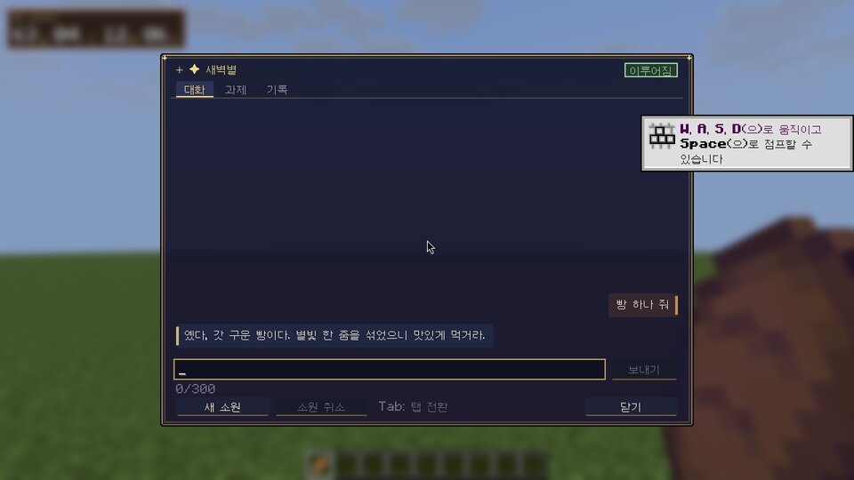
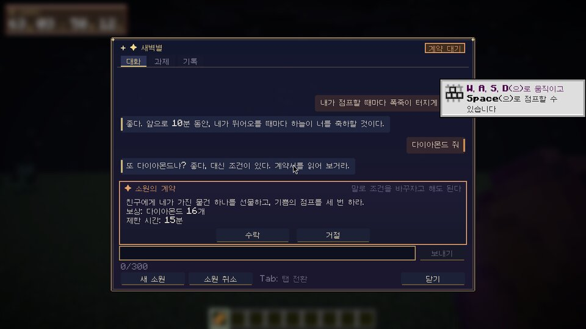
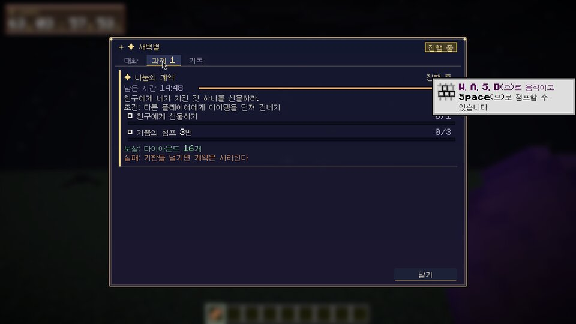
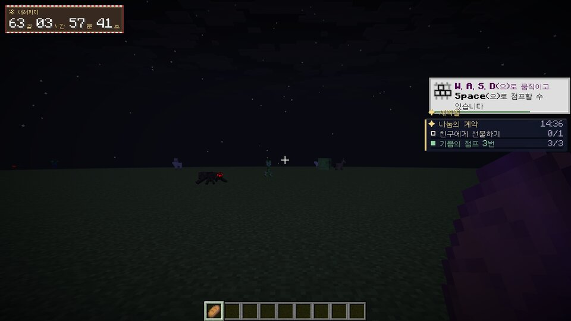
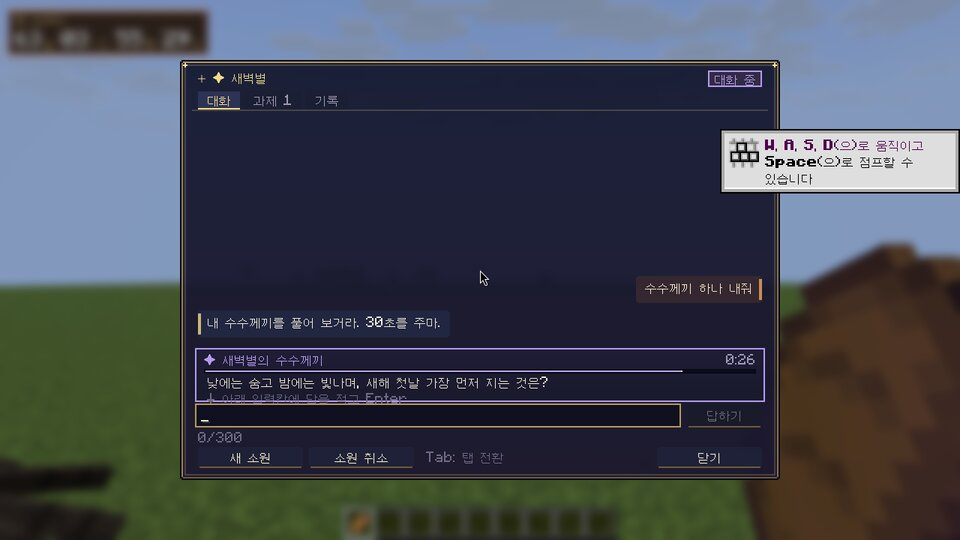
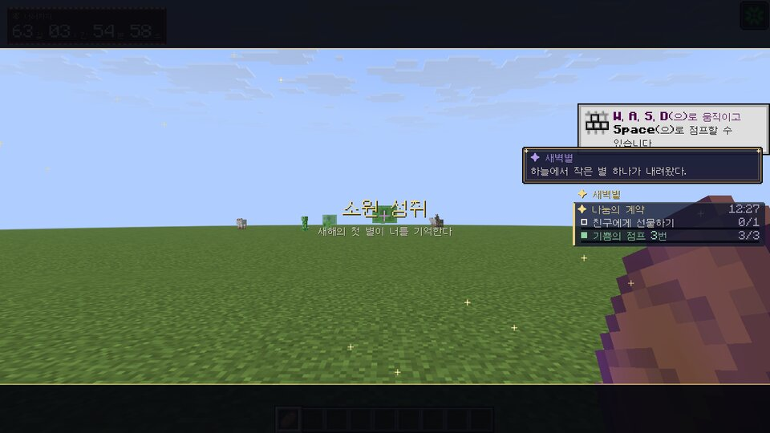
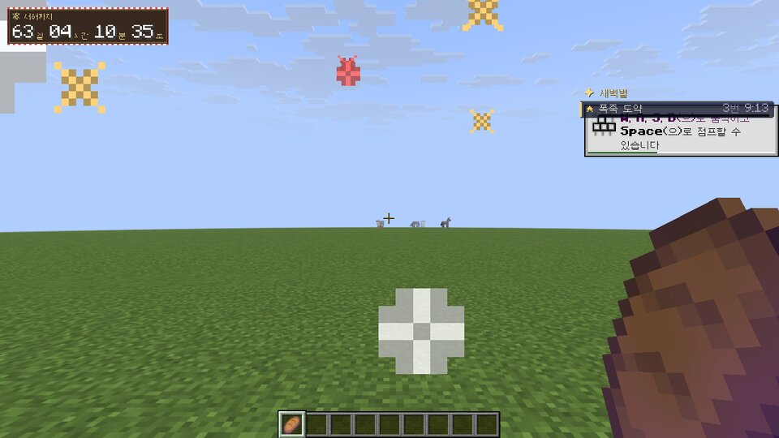
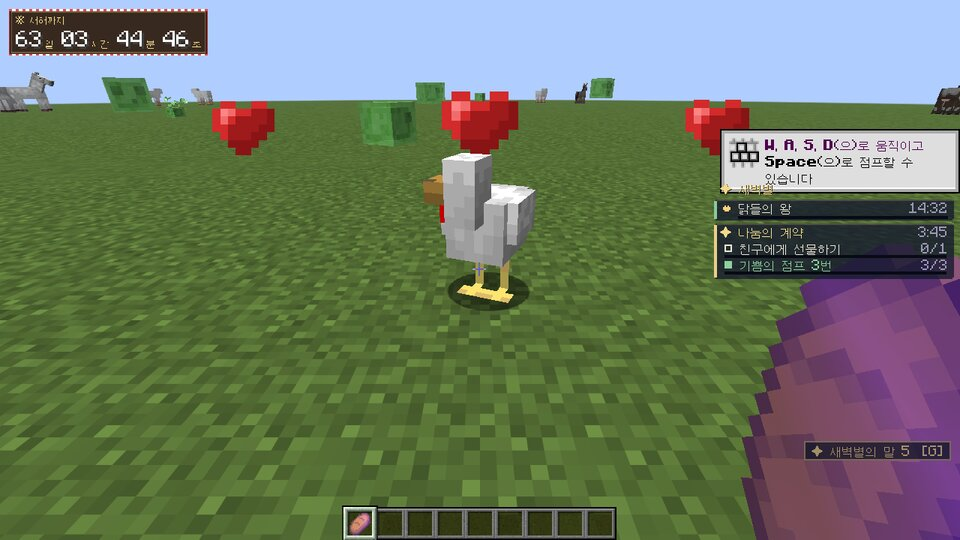

# AI 소원 엔진 — 새벽별 (AI Wish & World Creation Engine)

플레이어가 자연어로 소원을 빌면 AI(새벽별)가 들어줄지 판단하고, 협상하고, 필요하면 **서버 안에서 실행되는 새 게임 로직(WishScript)을 직접 작성·검증·실행**한다.
만들어진 능력·규칙·퀘스트·생명체는 세계에 남고, AI 는 그 일을 기억해 다음 소원과 자율 사건에 이어 쓴다.

> 이 문서의 내용은 실제 구현과 맞춘 것이다. 실제 OpenAI 모델(`gpt-6.1-terra`)로는 아직 시험하지 못했다(키 없음) — 아래 「시험한 내용」 참고.

---

## 1. 전체 구조

```
플레이어 ─(대화 화면 G / /wish / 소원 연등)─▶ WishManager ─▶ WishAgent (작업 스레드)
                                                         │   OpenAI Responses API (도구 호출 루프, 구조화 출력)
                                                         │      ▲          │ function_call
                                                         │      │결과      ▼
                                                         └──── Tools (서버 스레드에서 실행, 입력 검증)
                                                                 ├ 세계/플레이어 조회 · 기억 검색/저장
                                                                 ├ 스크립트 검증(모의 실행)·활성화·수정·정지
                                                                 ├ UI 도구(선택지·입력·계약·퀘스트·알림·시네마틱)
                                                                 └ 소원 상태 관리
ScriptManager ── WishScript 인터프리터(샌드박스) × N ── 게임 이벤트 버스(믹스인/Fabric 이벤트)
UiService ──(선언형 UI JSON 패킷)──▶ 클라이언트 디자인 시스템(대화 화면·퀘스트 패널·HUD·토스트·시네마틱)
MemoryStore(플레이어/세계/서사 기억) · AiState(소원·퀘스트·스크립트·상태) · UsageTracker → 월드 폴더 JSON
AutonomyManager: 의미 있는 사건이 생겼을 때만 AI 에게 자율 판단을 맡김
```

| 계층 | 패키지 | 주요 클래스 |
|---|---|---|
| AI | `ai.openai`, `ai.agent` | `OpenAiClient`(재시도·Rate limit·취소), `AgentRunner`(도구 루프·출력 복구), `WishAgent`(큐·동시성·예산·병합), `Tools`, `Prompts`, `ContextBuilder`, `ApiDocs` |
| 스크립트 | `ai.script.lang` | `Lexer`/`Parser`/`Interpreter`(JS 부분집합), `Budget`, `StaticChecker`, `Stdlib` — Minecraft 와 무관한 순수 자바 |
| 스크립트 ↔ 게임 | `ai.script`, `ai.script.api` | `ScriptApi`(전역 API), `PlayerRef`/`EntityRef`/`QuestRef`, `Policy`(권한·범위·수량), `ScriptValidator`(검증·모의 실행), `ScriptManager`(생명주기·스케줄러·이벤트·행동·영역·정리) |
| 소원 | `ai.wish` | `Wish`(상태 기계), `WishManager`, `Quest`/`QuestService`, `StatusEntry` |
| 기억 | `ai.memory` | `MemoryRecord`, `MemoryStore`(중복 제거·검색·요약 대체·가지치기) |
| UI | `ai.ui`, `ai.net`, `client.ai` | `UiService`(서버), `AiPackets`, `AiClientState`, `WishUi`(디자인 시스템), `WishChatScreen`, `AiHud` |
| 세계 | `ai` | `GameEvents`(이벤트 연결), `ai.mixin.*`, `AutonomyManager` |
| 관리 | `ai` | `AiCommands`, `AiConfig`, `AiStorage`, `UsageTracker`, `SelfTest` |

### 스크립트 언어를 직접 만든 이유
후보(Lua/LuaJ, Rhino/GraalJS, 별도 프로세스, DSL)를 비교한 결과 **자바스크립트 부분집합 인터프리터를 직접 구현**했다.
- AI 가 가장 잘 쓰는 문법(화살표 함수·구조 분해·템플릿 문자열)을 그대로 쓸 수 있다 → 표현력.
- 언어 차원에서 자바 객체·리플렉션·파일·네트워크·스레드에 닿는 경로가 **아예 없다**. 스크립트는 `HostObject` 로 노출한 API 만 본다.
- 모든 노드 평가가 예산(단계 수·할당량·호출 깊이·실제 시간)을 소모하므로 무한 루프·폭주 재귀·메모리 폭주를 확실히 끊을 수 있다(예산 오류는 `try/catch` 로도 잡히지 않음).
- 서버 JVM 안에서 돌지만 외부 프로세스 없이 틱 단위로 정밀하게 스케줄된다.

## 2. 실제로 완성된 기능

- **소원 입력**: 대화 화면(기본 키 `G`), `/wish <소원>`, 기존 **소원 연등**(연등이 떠오른 뒤 새벽별이 응답).
- **자유로운 판단**: 즉시 허락/거절/일부/질문/협상/계약/조건/퀘스트/대가/시간 제한/부작용/단계적 실현 — 고정 패턴 없이 모델이 고른다. 시스템 지시문은 공정성·기억 정직성·안전 규칙을 강제한다.
- **Tool calling 루프**: 여러 번 조회→계획→스크립트 작성→검증→수정→실행→UI 표시. 단순 소원은 1~2회 호출로 끝난다.
- **런타임 프로그래밍**: AI 가 쓴 WishScript 가 이벤트 구독·타이머·영역·상태 저장·엔티티 행동·블록·연출·UI·퀘스트·기억을 조합해 새 게임플레이를 만든다. 검증 실패 시 오류(줄:칸, "did you mean")가 AI 에게 돌아가 고쳐서 다시 시도한다.
- **지속성**: 능력·규칙 스크립트, 그 상태(`state`), 이름 붙은 타이머, 엔티티 행동, 퀘스트 마감, HUD 상태가 서버 재시작 후 복구된다. 주인이 접속해 있지 않아 초기화가 실패하면 주인이 들어올 때 다시 시작한다.
- **통합 UI**: 대화 화면(대화/과제/기록 탭, 응답 대기 애니메이션, 빠른 답, 선택지·입력·계약·동의 카드, 남은 시간 막대), 퀘스트 패널, 오른쪽 HUD(능력·저주·타이머·퀘스트 진행률, `J` 로 접기), 알림 토스트, 레터박스 시네마틱, AI 가 그리는 픽셀 아이콘. 재접속 시 대화·대기 중인 선택지·퀘스트·HUD 가 복구된다.
- **상호작용 검증**: 모든 UI 응답은 고유 ID + nonce. 서버가 주인·만료·중복·재전송·선택지 범위를 검증한다.
- **기억**: 플레이어 사적 기억/세계 공개 기억/서사 연결(thread·related), 관련성(한글 2-gram)·중요도·최근성 점수 검색, 중복 병합, 한도 가지치기, AI 요약으로 오래된 기억 접기. 검색 결과에는 **실제 세계 상태 주석**(스크립트가 지금 ACTIVE/STOPPED/FAULTED 인지, 엔티티가 지금 어디 있는지)이 붙는다.
- **자율 세계 발전**: 오랜만의 접속, 사망, 기억 속 장소 재방문(들어오는 순간), 퀘스트 종료, 특별한 아이템 줍기, 주기적 판단 — 쿨다운·시간당 한도·예산 비율 안에서만 AI 를 부른다. 아무것도 안 하기로 할 수도 있다.
- **운영**: 요청 큐·동시 호출 제한·시간 초과·재시도(지수 백오프, Retry-After)·Rate limit/Quota 구분·취소·플레이어별 쿨다운/일일 한도·서버 일일 예산·토큰/캐시 토큰/추론 토큰/비용/오류율/지연 집계, 킬 스위치, 승인 정책, 스크립트 검사기.
- UI 채널을 모르는 클라이언트에는 채팅 메시지와 클릭 가능한 선택지(`/wish answer`)로 대신 보낸다(폴백).

## 3. 추가·변경된 파일

- 신규: `src/main/java/dev/newyear/countdown/ai/**` (서버·공용), `src/main/java/dev/newyear/countdown/client/ai/**` (클라이언트), `src/main/resources/newyearcountdown.ai.mixins.json`, `src/test/java/**`, `docs/WISH_AI.md`, `docs/wish-ai/*.jpg`.
- 변경(최소): `NewYearCountdown`(엔진 등록 3줄), `NewYearCountdownClient`(패킷 수신·HUD·키 2개), `wish/WishLaunch`(연등 소원을 AI 로 전달 1줄), `fabric.mod.json`(공용 믹스인), 언어 파일(키 이름), `build.gradle`(JUnit 테스트). 기존 기능은 그대로다.

## 4. API 키와 모델 설정

1. 서버를 실행하는 환경에 `OPENAI_API_KEY` 환경 변수를 설정한다. 키는 서버에서만 읽으며 설정 파일·패킷·로그·JAR 어디에도 쓰지 않는다.
2. 서버 첫 실행 시 `config/newyearcountdown-ai.json` 이 생긴다. 주요 항목:

| 키 | 기본값 | 설명 |
|---|---|---|
| `model` | `gpt-6.1-terra` | Responses API 모델 |
| `reasoningEffort` / `autonomyReasoningEffort` | `medium` / `low` | 추론 강도 |
| `apiBase` | `https://api.openai.com/v1` | 프록시를 쓸 때만 변경 |
| `requestTimeoutSeconds`, `maxRetries` | 90, 3 | 요청 제한 시간·재시도 |
| `maxConcurrentRequests`, `maxQueuedRequests` | 3, 24 | 동시 호출·대기열 |
| `maxToolRounds`, `maxToolCallsPerTurn`, `maxOutputTokens` | 14, 48, 16000 | 한 턴의 도구 루프 한도 |
| `priceInputPerMTok` / `priceCachedInputPerMTok` / `priceOutputPerMTok` | 2.5 / 0.25 / 15 | **실제 가격표에 맞게 관리자가 설정** (비용 추정용) |
| `dailyBudgetUsd`, `perPlayerDailyTurns`, `perPlayerCooldownSeconds` | 5.0, 60, 4 | 예산·한도 |
| `spiritName`, `extraInstructions` | 새벽별, "" | 페르소나 |
| `script*` | — | 단계/시간/메모리 예산, 리스너·타이머·엔티티·블록 수, 반경, 오류 한도 |
| `allowBlockPlacement`, `allowReplacingSolidBlocks` | true, false | 블록 정책 (기본: 빈 공간만) |
| `approvalRequiredApis`, `approvalBlockThreshold` | `world.setTime`, `world.setWeather` / 128 | 관리자 승인이 필요한 API·규모 |
| `requireConsentForOthers` | true | 다른 플레이어에게 해로운 조작은 동의 필요 |
| `autonomy*` | 켜짐, 주기 30분, 시간당 6회, 동시 4개, 블록 변경 금지 … | 자율 이벤트 |
| `memory*` | 플레이어 400 / 세계 1200 / 요약 시작 160 | 기억 |

`/wishai reload` 로 다시 읽는다 (동시 요청 수만 재시작 필요).

## 5. 플레이어가 소원을 비는 방법

- **`G`** (조작 설정 "소원 대화")로 대화 화면을 열고 소원을 적는다. 대화가 이어지는 동안은 같은 소원에 대한 대답이 된다. "새 소원" 버튼으로 새로 시작, "소원 취소"로 취소.
- **`/wish 빵 하나 줘`** — 채팅 명령. `/wish cancel`, `/wish history`.
- **소원 연등**을 들고 우클릭 → 소원을 적고 "연등 날리기" → 연등이 떠오른 뒤 새벽별이 답한다.
- AI 가 선택지·입력·계약 카드를 띄우면 화면이 자동으로 열린다(다른 화면이 열려 있으면 HUD 에 "새벽별이 대답을 기다린다 [G]").
- 계약 카드에서 **수락/거절**하거나, 말로 조건을 바꾸자고 하면 협상이 이어진다.

## 6. AI 가 쓸 수 있는 스크립트 API (요약)

모델은 `get_script_api(topic)` 도구로 실제 API 표에서 생성된 문서를 받는다(구현과 어긋나지 않음).

- **전역**: `owner`(소원을 빈 플레이어), `state`(재시작 후에도 유지되는 객체), `on/once/off(event, fn, filter?)`, `after/every/cancel`, `timer(name, ticks, data)`(재시작에도 유지), `emit(name, data)`, `region(name, center, radius)`, `now/tick/random/randomInt/chance/pick/shuffle/pos/offset/distance/seconds/minutes/log`, `Math/JSON/Object/Array/Number/String`.
- **world**: `time, day, isDay, isNight, weather, setTime*, setWeather*, block, blockState, isAir, surface, biome, findBlocks, setBlock, fill, structure, restoreBlocks, isLoaded, dimension` (* 승인 필요 기본값)
- **players / Player**: `online, get, near, count` / `pos, blockPos, eyePos, look, dimension, biome, health, maxHealth, food, xpLevel, gameMode, isSneaking, isSprinting, isOnGround, isInWater, heldItem, offhandItem, armor, inventory, countItem, hasItem, give(id,n,{name,lore,glow,data}), take, effect, clearEffect, hasEffect, effects, heal, feed, damage, giveXp, teleport, push, msg, actionbar, title, sound, distanceTo, is, lookingAt, data(key,value)`
- **entities / Entity**: `spawn(type,pos,{name,glow,baby,noAi,silent,invulnerable,keep,tame,equip}), display('text'|'block'|'item',pos,opts), near, get, mine` / `exists, pos, health, setName, glow, follow, orbit, stay, stopBehaviour, moveTo, lookAt, teleport, push, setAI, setSilent, setInvulnerable, setBaby, tame, sit, equip, keep, remove, distanceTo, data`
- **fx**: `particles, ring, sphere, spiral, line, points, burst, sound, firework(무해), lightning(시각 효과), text`
- **ui**: `notify, say, choices, input, consent, cinematic, status(HUD, 픽셀 아이콘), clearStatus, timer`
- **quests / Quest**: `create, get, active` / `add, set, done, progress, isComplete, state, complete, fail, remaining, objectives`
- **memory**: `remember(text,{importance,scope,kind,tags,thread,entity,pos}), recall(query)`
- **wish / script / ai**: `wish.complete/fail/state`, `script.stop/remaining/restored/version`, `ai.ask(text, data)`(중요한 순간에만 AI 재호출, 속도 제한)
- **이벤트**: `player_join, player_leave, chat, jump, move, item_use, item_pickup, item_give, item_drop, block_place, block_break, attack, kill, player_death, respawn, interact_entity, region_enter, region_leave, effect_added, effect_removed, dawn, noon, dusk, night, timer, custom, quest_completed, quest_failed, quest_progress, wish_state, ui_response`
  (점프·줍기·선물·버리기·블록 설치·상태 효과는 믹스인으로, 이동·영역·시간은 구독자가 있을 때만 10~20틱 간격으로 감지한다.)

예 — "점프할 때마다 별, 일곱 번째엔 고양이":
```js
state.jumps ??= 0;
on('jump', (e) => {
  state.jumps++;
  fx.particles('end_rod', e.player.pos(), {count: 10});
  if (state.jumps % 7 === 0) {
    const cat = entities.spawn('cat', e.player.pos(), {name: '별고양이', glow: true});
    after(seconds(20), () => cat.remove());
  }
  ui.status(owner, 'stars', {label: '별빛 도약', counter: (state.jumps % 7) + '/7'});
}, {player: owner});
```

### AI 도구 목록
`get_world_context, get_player_context, inspect_entities, inspect_region, get_active_content, search_memories, store_memory, get_wish_history, get_script_api, validate_script, activate_script, run_script, update_script, stop_script, show_dialogue, present_choices, request_text_input, propose_contract, request_consent, create_quest, update_quest, show_notification, show_cinematic, set_wish_state, get_wish_state` (25개). 최종 답은 `{say, mood, expect_reply, quick_replies}` 구조화 출력.

## 7. UI 사용법

| 화면 | 내용 |
|---|---|
| 대화 탭 | 새벽별/플레이어 말풍선, 응답 대기 별 애니메이션(도구 단계별 문구: "기억을 더듬는 중", "마법을 엮는 중" …), 빠른 답 칩, 선택지·입력(카운트다운)·계약·동의 카드 |
| 과제 탭 | 퀘스트 제목·설명·조건·목표별 진행 막대·남은 시간·보상·실패 조건·결과 |
| 기록 탭 | 최근 소원과 결과 |
| HUD | 오른쪽 가장자리: 알림 토스트 → 능력·저주·타이머(픽셀 아이콘·카운터·남은 시간) → 진행 중 퀘스트(첫 퀘스트 펼침). `J` 로 접기/펼치기. 시네마틱은 레터박스 + 2배 제목 + 떠오르는 별 |

조작: `G` 열기, `Tab` 탭 전환, `Enter` 보내기/답하기, 휠 스크롤.

| | |
|---|---|
|  |  |
|  |  |
|  |  |
|  |  |

(스크린샷: 실제 26.3 클라이언트를 소프트웨어 렌더링으로 실행해 찍음. 이때 AI 응답은 아래 설명한 로컬 가짜 서버가 만든 것이다.)

## 8. 기억·상태 저장 방식

월드 폴더 `newyearcountdown_ai/` 에 JSON 으로 저장한다(월드 저장 시, 2분마다, 종료 시). 쓰기는 임시 파일 → 원자적 이동, 이전 파일은 `.bak` 으로 남겨 손상 시 자동 복구한다.

| 파일 | 내용 |
|---|---|
| `state.json` | 소원(대화·계약·전이 이력·연결된 스크립트/퀘스트/기억·동의), 퀘스트, HUD 상태, 플레이어 프로필, 엔진 틱, 킬 스위치 |
| `scripts.json` | 스크립트 기록(코드·버전 이력·주인·소원·요청 ID·상태·기간·구독·API 사용·`state` JSON·엔티티·블록 변경 기록·이름 타이머·행동·권한) |
| `memory.json` | 기억 (사적/공개, 종류, 중요도, 태그, thread, 연결, 엔티티/스크립트/위치 참조, 요약 여부) |
| `usage.json` | 오늘/누적 토큰·비용·오류 |

AI 의 기억(`memory.json`)과 실제 게임 상태(`state.json`, `scripts.json`)는 따로 저장하고, AI 에게 기억을 줄 때 실제 상태와 대조한 주석을 붙인다.

## 9. 관리자 명령 (`/wishai`, OP 2 이상)

| 명령 | 설명 |
|---|---|
| `status` | 켜짐/킬 스위치, 모델, 키 유무, 오늘·누적 토큰(캐시·추론)/비용/예산, 평균 응답 시간, 오류율, 큐, 스크립트·소원·퀘스트·기억 수 |
| `disable` / `enable` | **킬 스위치**: AI 호출 차단 + 모든 스크립트 일시정지(세계 결과물은 유지) / 해제 |
| `scripts [all\|플레이어]`, `script <id> [code\|stop\|rollback\|suspend\|resume\|revert\|delete]` | 스크립트 검사기 (rollback = 블록까지 되돌림, revert = 이전 코드 버전) |
| `approve <id>` / `deny <id>` | 승인 대기 스크립트 |
| `wishes [플레이어]`, `wish <id> [cancel]` | 소원 조회·취소 (전이 이력·최근 대화 포함) |
| `memory list <플레이어>`, `memory world`, `memory forget <id>`, `memory clear <플레이어\|world\|all>` | 기억 관리 |
| `autonomy <플레이어> <상황>` | 쿨다운을 무시하고 자율 판단 1회 |
| `run <코드>`, `validate <코드>` | 스크립트 직접 실행/검증 (시험·운영용) |
| `selftest` | 서버 안 통합 자가 진단 (가짜 플레이어 + 로컬 가짜 API) |
| `reload`, `save` | 설정 다시 읽기, 즉시 저장 |

## 10. 시험한 내용과 결과

- **단위 테스트 30개 통과** (`./gradlew test`): 인터프리터(문법·클로저·구조 분해·switch/try·표준 라이브러리·단계/메모리/재귀 예산·예산 오류는 catch 불가·자바 접근 불가·정적 검사), OpenAI 클라이언트+도구 루프(가짜 HTTP 서버: 도구 왕복, 429/503 재시도, quota 비재시도, 잘못된 출력 복구, 라운드 한도, 키 미설정, **본문에 키가 들어가지 않음**), 기억(한글 검색, 사적/공개 분리, 중복 병합, 가지치기, 서사 연결, 요약 대체).
- **실제 26.3 데디케이티드 서버에서 `/wishai selftest` 30/30 통과**: 일회성 지급, 점프 이벤트(믹스인→이벤트 버스→필터), HUD 전송, 엔티티 소환·행동·정지 시 정리, 빈 공간 블록 설치·임시 블록 복구, 기존 블록 덮어쓰기 거부, 무한 루프/폭주 코드/자바 접근 차단, 아이템 선물 감지→퀘스트 진행→자동 완료→보상, 상태 보존 복구, 주인 오프라인 복구 대기→접속 시 재개, UI 상호작용(다른 플레이어 응답 거부, 중복 무시), 가짜 Responses 서버를 통한 전체 소원 흐름 3종(빵 → run_script → 완료·기억 저장 / 잘못된 스크립트 → 검증 오류가 모델에게 전달 → 수정 → 활성화 / 계약 제안 → 수락 → 퀘스트+추적 스크립트 생성).
- **실제 서버 재시작**: 타이머 스크립트 카운터가 재시작 후 이어서 증가(7→33), 남은 지속 시간 유지, 소환된 고양이·퀘스트 마감·능력 HUD 복구 확인.
- **실제 클라이언트(소프트웨어 GL) + 서버 + 로컬 가짜 API 서버(시나리오 스크립트)로 화면 확인**: 시나리오 A(빵), D(점프 폭죽: 검증 실패→수정→활성화→시네마틱, 점프마다 폭죽·HUD 카운터), B/C(계약 카드 → 수락 → 퀘스트 패널·HUD 실시간 진행, 진행 갱신 중 AI 호출 없음), E(주변 닭 6마리 행동 제어·웅크리면 하트), F(고양이 기억 회상: 검색 결과에 "entity exists at 2,-60,0", 예전 능력 "FAULTED" 주석), G(기억 속 장소에 다시 들어올 때 자율 사건), H(수수께끼 입력 + 30초 타이머, 정답 판정은 스크립트가 로컬로), API 장애(가짜 서버 중단 → 재시도 후 안내 문구, 서버 정상), 킬 스위치, 재접속 시 대화·대기 중인 계약 카드 복구, 소원 연등 → AI 응답.
- 이 과정에서 발견해 고친 실제 버그: 26.3 의 SDL 마우스 버튼 번호(왼쪽=1), 주인 오프라인 상태의 복구 실패, 일회성 스크립트가 띄운 입력창이 즉시 닫히던 문제, 진행 중 소원에 새 소원이 섞이던 문제, 방금 만든 장소에서 자율 사건이 바로 터지던 문제, 비어 있는 서버의 일시정지 등.

**하지 못한 시험**: 실제 OpenAI API(`gpt-6.1-terra`) 호출 — 이 환경에 API 키가 없다. 실제 모델의 판단 품질·스크립트 작성 품질·가격은 키를 넣고 확인해야 한다. 여러 실제 클라이언트 동시 접속 시험은 가짜 플레이어 2명으로 대신했다.

## 11. 남은 기술적 제약

- 실행 중에 새 블록/아이템 **타입**을 등록할 수 없다(레지스트리 고정). 대신 바닐라 아이템 + 이름/설명/광택/`custom_data`(특별한 아이템), 바닐라 디스플레이 엔티티(텍스트·블록·아이템 홀로그램, 크기·회전), 파티클 패턴, 폭죽, 사운드 조합, AI 가 그리는 HUD 픽셀 아이콘으로 "새 외형"을 만든다 → 모두 바닐라 렌더링이라 접속한 모든 플레이어가 같은 모습을 본다.
- 동적 텍스처·절차적 3D 모델·새 엔티티 AI(골)는 구현하지 않았다(행동은 follow/orbit/stay/moveTo 경로 탐색 조합).
- 스크립트의 `after/every` 는 재시작 시 최상위 코드가 다시 만들도록 설계되어 있다(`timer(name, …)` 만 그대로 이어짐). 클로저 자체는 직렬화하지 않는다.
- 스크립트 메모리 한도는 "할당 단위" 근사치다(실제 바이트 측정 아님). 한 번 실행당 시간 한도로 보완한다.
- 블록 롤백은 스크립트가 바꾼 블록만 되돌리며, 그 사이 플레이어가 바꾼 칸은 건드리지 않는다.
- 비용은 설정의 단가로 추정한다(모델 가격표는 관리자가 입력).
- 26.3 서버는 빈 서버를 일시정지한다(`pause-when-empty-seconds`) — 그동안 스크립트·자율 이벤트도 멈춘다.

## 12. 미구현 기능

- 다른 플레이어에게 **사적 기억을 공유**하는 정책 세분화(지금은 사적/공개 두 단계).
- 관리자용 GUI (명령어로만 제공). 스크립트 코드 편집은 `update_script`(AI)·`revert`(관리자)로만.
- 블록 변경 "시뮬레이션 미리보기" 화면(검증 단계에서 효과 목록만 텍스트로 제공).
- 임베딩 기반 의미 검색(키워드·2-gram 점수로 대신).

## 13. 빌드와 JAR

```
./gradlew build      # build/libs/newyear-countdown-1.1.0.jar
./gradlew test       # 단위 테스트
```
서버와 클라이언트 모두 같은 JAR 과 Fabric API 가 필요하다(기존 모드와 같음).
